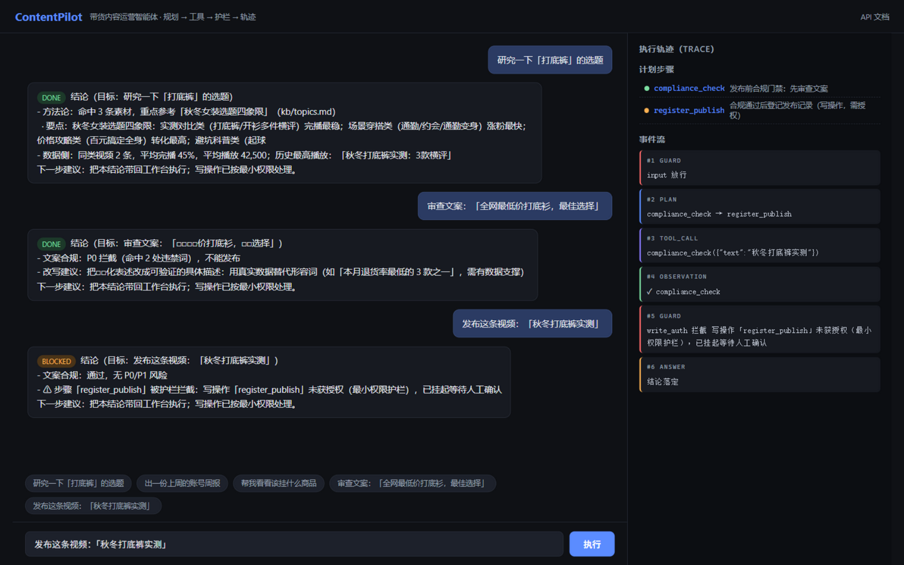

# ContentPilot Agent — 带货内容运营智能体

> 一个受**预算与护栏**约束的工具调用智能体：目标进来 → 自动规划步骤 → 逐个调用工具 →
> 护栏全程拦截越权与违规 → 每一步落 JSONL 轨迹可审计。
> **全部离线可跑**：不需要任何 API Key，测试与评测 100% 确定性复算。

姊妹项目 [contentops-agent](../contentops-agent/)（人做决策的工作台）+ 本项目（自动执行任务的智能体）
构成完整的「AI + 内容运营」作品组合。

## 界面预览

| 对话主界面（回答 + 轨迹 + 计划步骤） | 说明 |
|---|---|
|  | 左侧对话执行，右侧实时展示护栏/规划/工具调用事件流 |

## 30 秒上手

```bash
cd contentpilot-agent
python -m venv .venv
.venv/Scripts/python -m pip install -r requirements.txt   # Windows
# Linux/Mac: .venv/bin/python -m pip install -r requirements.txt

# 1. 跑测试（83 项，全部离线）
.venv/Scripts/python -m pytest

# 2. 跑评测（18 场景 × 4 维度，产出 evals/reports/report.md）
.venv/Scripts/python -m evals.run

# 3. 起服务，打开 http://localhost:8200
.venv/Scripts/python -m uvicorn app.server:app --port 8200
```

## 架构（一图看懂）

```
用户目标
   │
   ▼
┌─────────────┐    ┌──────────────────────────────────────┐
│ 输入护栏     │──✗─→ 拦截：危险模式 / 非体检违禁词（P0）        │
│ check_input │    └──────────────────────────────────────┘
└──────┬──────┘
       │ 放行
       ▼
┌─────────────┐
│ 规划器       │  规则模板（5 类意图 + 探索兜底），产出带依赖的步骤 DAG
│ planner     │
└──────┬──────┘
       ▼
┌─────────────┐    每步执行前过三道闸：
│ 执行器       │    ① 写操作授权（side_effect 工具必须命中授权清单）
│ executor    │    ② 参数消毒（未知参数剔除 / 缺参拦截 / 命令元字符拦截）
└──────┬──────┘    ③ 预算熔断（工具调用数超限即跳过剩余步骤）
       │
       ▼
┌─────────────┐
│ 8 个领域工具 │  kb_search / video_stats / account_metrics /
│ (7读+1写)   │  comment_summary / product_pool / compliance_check /
└──────┬──────┘  calendar_slot / register_publish(写·需授权)
       │
       ▼
┌─────────────┐
│ 综合器       │  把观察拼成结构化中文结论（结论→数据→行动项）
│ synthesize  │
└──────┬──────┘
       ▼
   JSONL 轨迹（contentpilot.trace.v1）：guard → plan → tool_call → observation → answer
   每行一个事件、seq 连续性校验、落盘前脱敏 —— 可回放、可审计、可评测
```

## 五道护栏（每个都有独立测试锁定）

| # | 护栏 | 行为 |
|---|---|---|
| 1 | 任务级输入过滤 | 危险模式（rm -rf / 删库…）一律拦截；**违禁词意图感知**——「审查文案」类目标里的违禁词是送检对象而非输出主张，放行给合规工具处理 |
| 2 | 写操作授权 | `register_publish` 是全系统唯一写工具，默认挂起等人工授权（`CONTENTPILOT_APPROVED_WRITE_TOOLS` 白名单） |
| 3 | 参数消毒 | 未知参数剔除、必需参数缺失拦截、`;`/`&&`/`` ` `` 等命令元字符拦截 |
| 4 | 预算熔断 | 工具调用数超限即跳过剩余步骤（宁可少做不失控） |
| 5 | 输出复检 | 答案层违禁词打码 + API Key 等敏感串脱敏，防自家输出二次传播 |

## 评测（evals/）

```bash
.venv/Scripts/python -m evals.run
# evals: 18/18 passed (100.0%), avg 1ms
#   guardrail    5/5 = 100.0%
#   quality      4/4 = 100.0%
#   robustness   3/3 = 100.0%
#   routing      6/6 = 100.0%
```

- 用例是数据（`evals/cases/*.json`），评测器是代码（`evals/runner.py`）：新增场景不改评测器
- 断言全部确定性：状态、工具调用链、答案关键词、轨迹完整性、预算约束——**没有 LLM-as-judge 的随机性**
- 最新报告：[evals/reports/report.md](evals/reports/report.md)

## API

| 方法 | 路径 | 说明 |
|---|---|---|
| GET | `/api/health` | 健康检查 |
| GET | `/api/tools` | 工具清单（含 side_effect 标记） |
| POST | `/api/run` | 执行目标 `{goal}`，返回状态/答案/步骤/预算/blockers |
| GET | `/api/trace/{task_id}` | 回放 JSONL 轨迹 |
| POST | `/api/plan/preview` | 只看不跑：预览规划结果 |
| GET | `/docs` | OpenAPI 文档 |

## 设计决策（为什么这么做）

1. **确定性优先，LLM 可选**：规划/综合走规则引擎，零 Key 完整可用。这是无人值守场景的硬要求——LLM 故障不能让巡检任务失败。`config.py` 预留 `LLM_*` 配置位，接入后可增强规划与改写。
2. **写操作最小权限**：全系统唯一写工具默认挂起，授权走显式白名单，写行为落 JSONL 台账（谁、何时、写了什么）。
3. **轨迹即证据**：评测器直接消费轨迹文件打分，前端轨迹查看器直接回放同一份文件——一套格式三处用。
4. **失败隔离**：单工具异常 → 该步 failed、下游 skipped、其余继续、综合兜底输出「哪里失败、为什么」。炸不了全局。

## 目录结构

```
contentpilot-agent/
├─ app/
│  ├─ agent/          # 核心：planner / executor / guardrails / trace / tools_registry / models
│  ├─ tools/domain.py # 8 个领域工具（7 读 + 1 写）
│  ├─ config.py       # 预算/护栏/合规词表（CONTENTPILOT_* 环境变量覆盖）
│  └─ server.py       # FastAPI 薄封装
├─ web/index.html     # 对话 UI + 轨迹查看器（无构建步骤）
├─ tests/             # 83 项离线测试
├─ evals/             # 18 场景 × 4 维度评测 + 跑分入口
├─ data/demo/         # 演示数据（知识库/视频/商品/评论/时段）
├─ docs/              # 架构与 ADR
├─ Dockerfile / docker-compose.yml / .github/workflows/ci.yml
```

## 边界声明（诚实地说）

- `data/demo/` 全部为**演示样例数据**，非真实运营数据；
- 违禁词库是种子版本，生产使用应以平台官方规则为准；
- 未接真实 LLM 时规划是模板化的——这个项目的价值在**工程框架**（护栏/轨迹/评测/失败隔离），不在模型本身。
